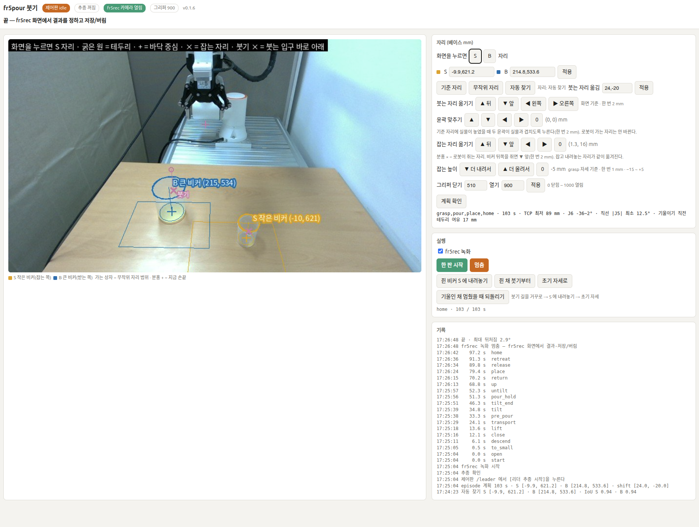
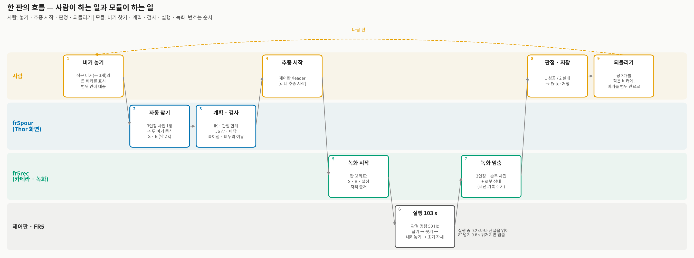
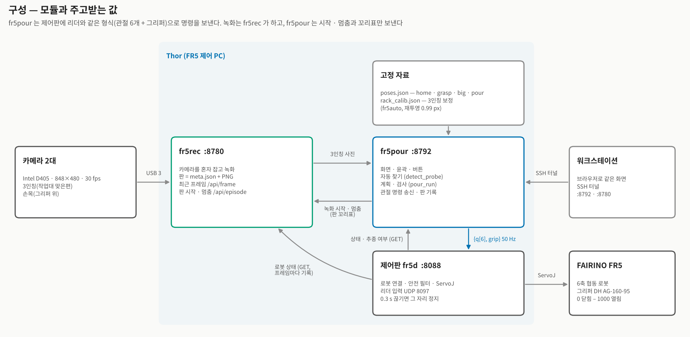
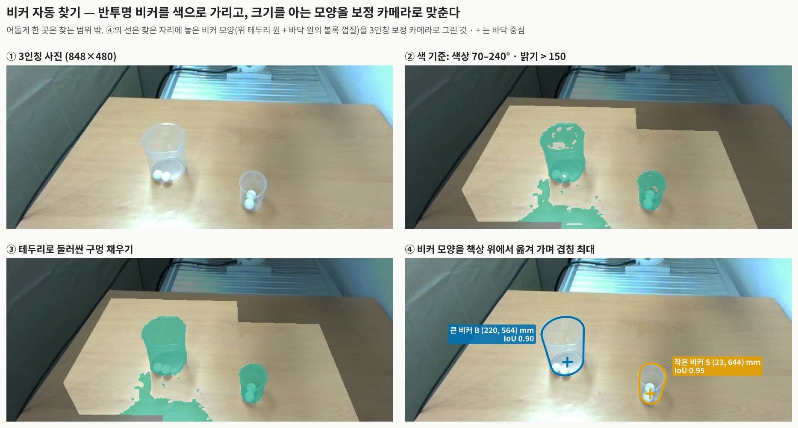
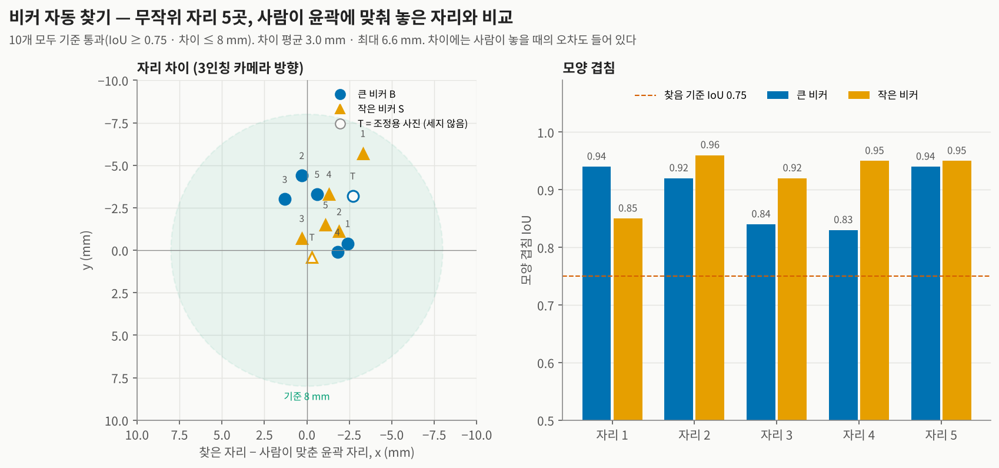
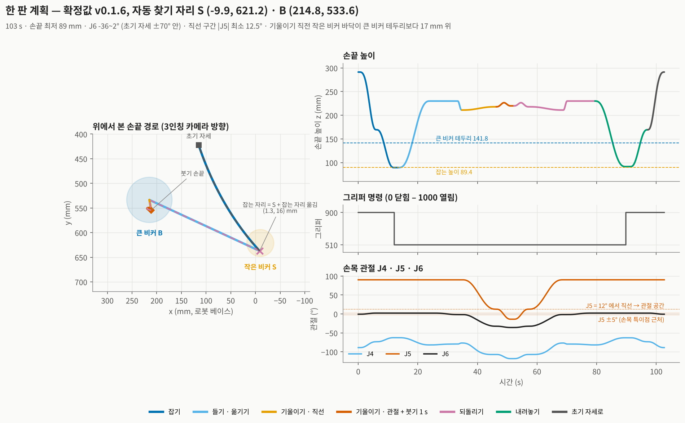
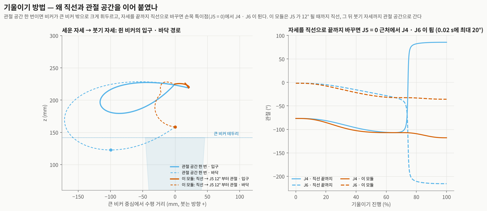
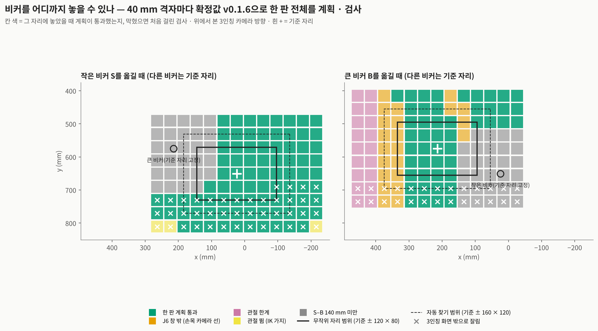
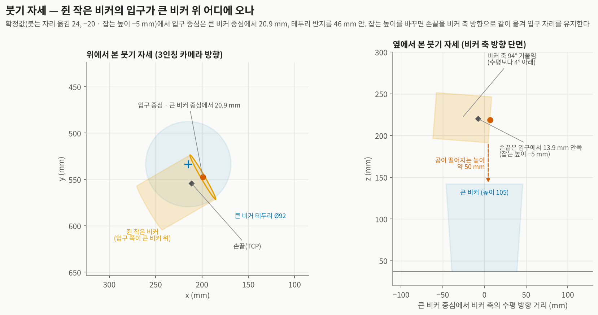

# 비커 붓기 자동 수집 모듈 fr5pour (FAIRINO FR5, 2026-11-16)

> - 과제: 작은 비커(공 3개)를 위에서 쥐어 들고, 기울여 큰 비커에 공을 붓고, 작은 비커를 제자리에 내려놓는다.
> - 모듈: Thor(FR5 제어 PC)의 버튼 화면 하나로 **비커 자리 찾기 → 계획 · 검사 → 실행 → fr5rec 녹화**를 한다. 사람은 비커를 놓고, 추종을 켜고, 결과를 판정한다.
> - 비커 자동 찾기: 반투명 비커를 색으로 가리고, 크기를 아는 비커 모양을 3인칭 보정 카메라로 그려 겹침이 가장 큰 책상 자리를 고른다. 무작위 자리 5곳에서 10개 모두 기준 통과(사람이 윤곽에 맞춘 자리와 차이 평균 3.0 mm, 최대 6.6 mm).
> - 궤적: 저장한 자세 4개(home · grasp · big · pour)와 비커 자리로 한 판(약 103 s)을 계획한다. 기울이기는 손목 특이점(J5 = 0)을 피하려고 J5 12°까지 직선, 그 뒤 관절 공간으로 간다.
> - 코드 v0.1.7(조정값은 v0.1.6 확정값 그대로, 0.1.7은 fr5rec가 녹화를 거절하면 실행하지 않는 검사만 더함). 성공률: 9절.

**English summary.** fr5pour is a one-screen data-collection module for a beaker-pouring task on a FAIRINO FR5 (6-DoF, DH AG-160-95 gripper, two Intel D405 cameras). A small beaker holding three balls is grasped at its rim from above, tilted over a large beaker until the balls fall in, and put back. The operator only places the beakers, starts leader following on the robot panel, and labels the result; the module finds both beakers in the third-person image, plans and checks the whole 103 s trajectory, streams joint commands at 50 Hz to the robot panel, and starts/stops the fr5rec recorder with a per-episode tag. Translucent beakers are found by colour masking (hue 70–240°, V > 150), hole filling, and fitting the known beaker silhouette (rim and base circles projected through the calibrated third-person camera) by IoU over the table plane. At five random placements all ten beakers were found (IoU 0.83–0.96) within 0.8–6.6 mm (mean 3.0 mm) of the positions a person had aligned by eye. Tilting uses a Cartesian segment until J5 reaches 12° and a joint-space segment for the rest: a single joint-space move swings the held beaker up to 171 mm off the large beaker, and a Cartesian move through the wrist singularity makes J4/J6 jump by up to 20° per 20 ms. The episode success rate is reported in section 9.



*fr5pour 화면 — 자동 찾기로 정한 자리에서 한 판을 끝낸 뒤. 왼쪽 에이전트뷰(3인칭)에 두 비커 윤곽(굵은 원 = 테두리, + = 바닥 중심), 분홍 × = 로봇이 쥐는 자리, '붓기' × = 붓기 자세에서 작은 비커 입구 바로 아래, 가는 상자 = 무작위 자리 범위. 오른쪽에 자리 · 조정값 · 실행 버튼 · 기록.*

**실행 영상** — 2026-11-16, [자동 찾기]로 정한 자리, 사람 판정 성공. 성공률(9절)을 재기 전 조정 단계의 판이라 집계에는 넣지 않는다.

| 영상 1 | 영상 2 |
|---|---|
| [pour_run1.mp4](media/pour_run1.mp4) | [pour_run2.mp4](media/pour_run2.mp4) |

<!-- README 안에서 바로 재생하려면: GitHub 웹에서 README.md 를 편집해 mp4 를 이 줄 아래로 끌어 놓는다(user-attachments 주소가 들어가면 재생된다). -->

---

## 1. 과제와 장비

| 항목 | 값 |
|---|---|
| 로봇 | FAIRINO FR5 (6축) · 공구 1 = 플랜지 + 168.4 mm |
| 그리퍼 | DH AG-160-95, 명령 0 닫힘 – 1000 열림. 작은 비커 윗부분을 510으로 쥠, 900으로 엶 |
| 카메라 | Intel D405 2대, 848×480, 30 fps — 3인칭(작업대 맞은편) · 손목 |
| 제어 PC | Thor — 제어판(fr5d), fr5rec, fr5pour 가 함께 돈다 |
| 작은 비커 | 위 지름 55 mm, 높이 66.5 mm, 반투명 플라스틱, 공 3개 |
| 큰 비커 | 위 지름 92 mm, 높이 105 mm, 반투명 플라스틱 |
| 책상 높이 | 로봇 베이스 기준 z = 36.8 mm (grasp 자세 손끝 94.8 − 자로 잰 손끝 높이 58) |
| 붓기 | 붓기 자세에서 1 s 멈춤 |

좌표는 모두 로봇 베이스 기준 mm다. 위에서 본 그림은 3인칭 카메라에서 본 방향으로 그렸다(로봇 x+ = 화면 왼쪽, y+ = 화면 아래 · 카메라 쪽).

---

## 2. 한 판의 흐름



| 순서 | 누가 | 하는 일 |
|---|---|---|
| 1 | 사람 | 작은 비커(공 3개)와 큰 비커를 표시 범위 안에 놓는다. [무작위 자리]를 누르면 다음에 놓을 자리가 윤곽으로 보인다. 정확히 맞출 필요는 없다 |
| 2 | fr5pour | [자동 찾기] — fr5rec 의 최근 3인칭 사진 1장에서 두 비커 중심 S · B를 찾는다(Thor에서 약 2.2 s). 두 비커 모두 기준(IoU 0.75)을 넘을 때만 자리를 바꾼다 |
| 3 | fr5pour | [한 판 시작] — 지금 로봇 명령 자세에서 시작하는 한 판을 계획하고 검사한다(5.5절). 하나라도 걸리면 보내지 않는다 |
| 4 | 사람 | 제어판 /leader 에서 [리더 추종 시작]. fr5pour 는 지금 자세를 보내며 추종이 켜지길 기다린다(최대 3분) |
| 5 | fr5pour → fr5rec | 녹화 시작. 판 꼬리표(8절)에 자리 · 설정 · 자리 출처가 들어간다 |
| 6 | fr5pour → 제어판 | 계획한 관절 명령을 50 Hz로 보낸다. 0.2 s마다 로봇 관절을 읽어 명령보다 8° 넘게 0.6 s 뒤처지면 멈춘다 |
| 7 | fr5pour → fr5rec | 초기 자세로 돌아온 뒤 녹화 멈춤 |
| 8 | 사람 | fr5rec 화면에서 1 성공 / 2 실패 → Enter 저장 |
| 9 | 사람 | 공 3개를 작은 비커에 되돌리고 비커를 다시 놓는다 → 1로 |

판 사이 되돌리기(공 넣기)는 사람이 한다. 큰 비커 위 지름(92 mm)이 그리퍼 최대 폭(95 mm)과 거의 같아 로봇이 되붓지 않는다.

---

## 3. 구성



| 연결 | 내용 |
|---|---|
| fr5pour → 제어판 | UDP 8097, `{sid, seq, q[6] (°), grip (0 닫힘–1 열림)}` 50 Hz. 리더 송신기와 같은 형식. 0.3 s 동안 안 오면 제어판이 그 자리에 선다 |
| 제어판 → fr5pour | `GET /api/state` (mode · joints · cmd · tcp · gripper.pos), `GET /api/leader/state` (following) |
| fr5rec → fr5pour | `GET /api/frame/third.jpg` (기록 중에도 최근 프레임), `GET /api/camera/state` (open · recording) |
| fr5pour → fr5rec | `POST /api/episode/start {tag}`, `POST /api/episode/stop {reason}` (`X-FR5REC` 헤더) |
| 고정 자료 | `poses.json` — 조그로 맞춘 자세 grasp(작은 비커를 쥐는 자세) · big(쥔 작은 비커를 큰 비커 위 동심으로 둔 자세). home · pour 는 코드 기본값. `rack_calib.json` — 받침 과제 모듈(fr5auto)의 3인칭 보정(데이터 보정, 재투영 0.99 px) |
| 화면 | Thor `127.0.0.1:8792`. 다른 컴퓨터에서는 SSH 터널(`ssh -N -L 8792:127.0.0.1:8792 <Thor 주소>`) |

기준 자리(비커를 처음 맞춘 자리)는 저장 자세의 손끝 위치에서 나온다: 작은 비커 S_ref = (24.1, 650.7), 큰 비커 B_ref = (214.3, 575.1).

---

## 4. 비커 자동 찾기



비커는 투명에 가까운 뿌연 플라스틱이라 색 하나로는 경계가 깨끗하지 않다. 대신 크기와 카메라를 알고 있으므로, 사람이 화면에서 윤곽을 맞추던 일을 컴퓨터가 한다.

| 단계 | 방법 | 값 |
|---|---|---|
| ① 찾는 범위 | 기준 자리 ± (160, 120) mm 상자를 책상 높이와 큰 비커 높이에서 화면에 그려, 그 볼록 껍질 안만 본다 | 무작위 자리 범위(± 120 × 80)보다 40 mm 넓음 |
| ② 색 기준 | HSV에서 색상과 밝기로 비커 픽셀을 고른다. 나무 책상은 색상 약 40–60°, 비커는 푸른 기가 도는 흰색(약 95–180°) | 색상 70–240°, 밝기 > 150 |
| ③ 구멍 채우기 | 투명한 몸통 너머로 책상이 비친 곳은 비커 픽셀에서 빠진다. 테두리로 둘러싸인 구멍을 채운다(가장자리에서 배경 채우기) | — |
| ④ 모양 맞추기 | 책상 위 (x, y)에 비커를 놓았다고 보고, 위 테두리 원(반지름 r, 높이 H)과 바닥 원(0.85 r, 책상 높이)을 3인칭 보정 카메라로 투영해 볼록 껍질(실루엣)을 만든다. 실루엣과 ③의 겹침(IoU, 실루엣 둘레 12 px 창 안)이 가장 큰 자리를 찾는다 | 8 mm 격자 → ± 10 mm 안 2 mm → ± 2.5 mm 안 0.5 mm |
| ⑤ 두 비커 | 큰 비커를 먼저 찾고, 찾은 실루엣을 지운 뒤 작은 비커를 찾는다 | — |
| ⑥ 받아들이기 | 두 비커 모두 IoU ≥ 0.75 일 때만 S · B를 바꾼다. 아니면 '자동 찾기 실패'와 두 IoU를 띄운다 | 기준 0.75 |

**검증** — [무작위 자리] 5곳. 사람이 두 비커를 윤곽에 맞춰 놓은 자리와, 같은 사진에서 찾은 자리를 비교. 기준(결과를 보기 전에 정함): 10개 모두 IoU ≥ 0.75, 차이 ≤ 8 mm.



| 자리 | 큰 비커 IoU | 큰 비커 차이 (mm) | 작은 비커 IoU | 작은 비커 차이 (mm) |
|---|---|---|---|---|
| 1 | 0.94 | 2.5 | 0.85 | 6.6 |
| 2 | 0.92 | 4.5 | 0.96 | 2.2 |
| 3 | 0.84 | 3.3 | 0.92 | 0.8 |
| 4 | 0.83 | 1.8 | 0.95 | 3.5 |
| 5 | 0.94 | 3.4 | 0.95 | 1.9 |

- 10개 모두 통과. 차이 평균 3.0 mm(큰 3.1 · 작은 3.0), 최대 6.6 mm. 한 자리 찾는 데 약 2.2 s.
- 차이에는 사람이 윤곽에 맞춰 놓을 때의 오차가 들어 있어 찾기 오차만 따로 떼지 못한다. 앞뒤(y) 차이는 10개 중 9개가 음수(평균 −2.4 mm, 찾은 자리가 로봇 쪽)다. 원인(사람이 놓는 버릇 · 보정 치우침)은 미확인.
- 조정에 쓴 사진 1장(그림의 T)은 세지 않는다. 이 사진의 IoU는 구멍 채우기 전 0.73 · 0.67(위치는 맞지만 기준 아래), 채운 뒤 0.94 · 0.93.
- 창 반사광은 푸른 흰색이라 ②에서 비커 픽셀로 같이 잡힌다(①–③ 그림 아래쪽). 비커 모양과 겹치지 않아 ④의 자리에는 영향이 없다(5곳 모두).

---

## 5. 궤적

### 5.1 한 판 계획



자동 찾기 자리 S (−9.9, 621.2) · B (214.8, 533.6), 확정값 v0.1.6으로 계획한 한 판이다(실물 기록의 단계 시각과 같다).

| 단계 | 시작 (s) | 길이 (s) | 움직임 | 속도 |
|---|---|---|---|---|
| open | 0.0 | 0.5 | 그리퍼 900 | — |
| to_small | 0.5 | 5.6 | 관절 공간 → 잡는 자리 위 80 mm | 관절 10 °/s |
| descend | 6.1 | 6.0 | 직선 아래로 → 잡는 높이 89.4 mm | 25 mm/s |
| close | 12.1 | 1.5 | 그리퍼 510 | — |
| lift | 13.6 | 10.5 | 직선 위로 → 230 mm | 25 mm/s |
| transport | 24.1 | 9.2 | 직선, 손목 방향을 big 자세로 → 큰 비커 위 | 50 mm/s, 20 °/s |
| pre_pour | 33.3 | 1.5 | 직선 아래로 → 211 mm (작은 비커 바닥이 큰 비커 테두리보다 17 mm 위) | 25 mm/s |
| tilt | 34.8 | 11.6 | 직선(위치 · 자세를 붓기 자세 쪽으로), J5가 12°가 되는 곳까지(경로의 78%) | 25 mm/s, 20 °/s |
| tilt_end | 46.3 | 5.0 | 관절 공간 → 붓기 자세 | 관절 10 °/s |
| pour_hold | 51.3 | 1.0 | 멈춤 — 공이 떨어진다 | — |
| untilt | 52.3 | 16.5 | 기울이기 길을 거꾸로 → 세운 자세 | 위와 같음 |
| up · return | 68.8 | 10.6 | 230 mm로 → 작은 비커 자리 위 | 25 · 50 mm/s |
| place | 79.4 | 10.4 | 직선 아래로 → 잡는 높이 + 2 mm | 25 mm/s |
| release · retreat | 89.8 | 7.4 | 그리퍼 900, 위로 80 mm | 25 mm/s |
| home | 97.2 | 5.5 | 관절 공간 → 초기 자세 | 관절 10 °/s |

### 5.2 기구학 · 보간

- FK: FR5 DH (a = 0, −425, −395, 0, 0, 0 · d = 152, 0, 0, 102, 102, 100 · α = π/2, 0, 0, π/2, −π/2, 0) + 공구 168.4 mm. 제어판 TCP와 0.3–0.5 mm, 0.06° 안에서 같다.
- IK: 감쇠 최소제곱(수치 야코비안, 회전 1 rad = 100 mm 무게, λ = 1). 위치 0.5 mm 또는 자세 0.3°를 넘게 남으면 그 자리는 못 간다고 본다.
- 보간: 구간마다 최소 저크 s(τ) = 10τ³ − 15τ⁴ + 6τ⁵, 길이 T = max(1 s, 1.875 × 이동량 / 속도) — 최고 속도가 정한 속도와 같다. 직선 구간은 50 Hz 표본마다 IK를 풀어 관절로 바꾼다.

### 5.3 기울이기



붓기 자세는 손목 특이점(J5 = 0) 건너편(J5 = −12.7°)에 있다.

| 방법 | 결과 |
|---|---|
| 관절 공간 한 번 (세운 자세 → 붓기 자세) | 쥔 비커가 큰 비커 밖으로 휘두른다 — 바닥이 큰 비커 중심에서 최대 171 mm, 높이 122.7 mm(테두리 141.8 mm보다 아래)까지, 입구가 119 mm까지 |
| 직선(위치 · 자세) 끝까지 | J5 = 0 근처에서 J4 · J6 이 튄다(0.02 s에 최대 20°) |
| **이 모듈: 직선 → J5 12°부터 관절 공간** | 바닥은 큰 비커 중심에서 65 mm 안, 158 mm 위. 입구는 22 mm 안. 직선 구간 \|J5\| ≥ 12.5° |

### 5.4 그 밖의 동작 버튼

| 버튼 | 단계 | 쓰는 때 |
|---|---|---|
| [쥔 비커 S 에 내려놓기] | place · home | 쥔 채 멈췄을 때 |
| [쥔 채 붓기부터] | pour · place · home | 쥔 채 멈췄고 붓기부터 다시 |
| [초기 자세로] | up · home | 낮은 자리에서 멈췄을 때(먼저 곧게 위로). 비커를 기울인 채면 거절 |
| [기울인 채 멈췄을 때 되돌리기] | untilt · place · home | 붓기 중 멈췄을 때. 붓기 길을 거꾸로 되짚는다 |

### 5.5 보내기 전 검사 · 실행 중 감시

| 검사 | 기준 |
|---|---|
| IK | 모든 목표 자세가 풀림, 직선 구간 IK 오차 ≤ 1 |
| 관절 한계 | J1 ±175 · J2 −260~80 · J3 ±155 · J4 −260~80 · J5 ±170 · J6 ±170 ° |
| J6 창 | 초기 자세 J6 ± 70° 안 (손목 카메라 선) |
| 바닥 | 손끝 z ≥ 48 mm (제어판 바닥 한도 45 + 3) |
| 관절 뜀 | 50 Hz 표본 사이 관절 변화 ≤ 2° (IK 가지 바뀜 막기) |
| 손목 특이점 | 직선 구간 \|J5\| ≥ 5° |
| 테두리 여유 | 기울이기 직전 작은 비커 바닥이 큰 비커 테두리보다 ≥ 5 mm 위 |
| 비커 간격 | S–B 중심 ≥ 140 mm (잡을 때 그리퍼가 큰 비커에 닿지 않게) |

실행 중에는 0.2 s마다 제어판 관절을 읽는다. 제어판이 관절을 가끔 0으로 읽는 경우가 있어, 0이 섞인 읽기는 건너뛴다. 명령과의 차가 8°를 넘는 읽기가 3번 연속(0.6 s)이면 멈춘다. 멈추면 송신을 끊고(제어판이 0.3 s 뒤 그 자리에 선다), 녹화 중이면 `fr5pour 중단: 이유`로 녹화를 멈춘다. fr5rec가 녹화 시작을 거절하면(직전 판을 정하지 않은 경우 등) 로봇을 움직이지 않고 그 이유로 멈춘다(v0.1.7).


### 5.6 놓을 수 있는 범위



한 비커만 40 mm 격자로 옮기고(다른 비커는 기준 자리), 칸마다 확정값으로 한 판 전체를 계획 · 검사한 결과다([data/reach_map.csv](data/reach_map.csv), `scripts/make_reach_map.py`). 화면의 가는 상자는 [무작위 자리]가 뽑는 범위일 뿐 안전 한도가 아니다. 실제로 막는 것은 판마다 도는 5.5절 검사다. 상자 밖이라도 화면 누르기 · 좌표로 정했거나 자동 찾기 범위(± 160 × 120) 안에서 찾은 자리는 검사를 통과하면 실행된다.

| | 작은 비커 S | 큰 비커 B |
|---|---|---|
| 계획 통과 (117칸 중) | 85 — 막힌 칸은 S–B 거리(29)와 먼 구석 관절 뜀(3)뿐 | 48 — J6 창(22) · 관절 한계(18) · S–B 거리(29) |
| 막는 쪽 | 카메라 쪽(y ≳ 690)은 3인칭 화면 아래로 잘림 | 로봇 오른쪽(+x, 화면 왼쪽)은 J6 창(손목 카메라 선) → 더 가면 관절 한계 |
| 무작위 자리 상자 안 35칸 | 통과 28 · S–B 7, 그중 8칸이 화면 아래로 잘림(y ≈ 730) | 통과 21 · J6 7 · S–B 7, 모두 화면 안 |

- 큰 비커는 붓기 자세 하나를 평행 이동해 쓰므로, 로봇 오른쪽으로 갈수록 손목(J6)이 더 돌아 손목 카메라 선 한도(초기 자세 ± 70°)에 먼저 걸린다.
- 작은 비커는 계획상 거의 어디든 되지만, 카메라 쪽으로 오면 3인칭 화면에서 잘려 자동 찾기가 못 찾는다.

---

## 6. 붓기 자세의 기하



- 붓기 손끝 = 붓기 자세 손끝 + (B − B_ref) + 붓는 자리 옮김. 붓기 자세는 기준 자리에서 조그로 맞춘 관절값(108.09, −108.88, −112.14, −118.63, −12.73, −37.70)이고, 다른 자리에서는 같은 자세를 큰 비커가 옮겨진 만큼 평행 이동한다.
- 쥔 작은 비커의 축은 공구 z(아래쪽이 바닥)다. 붓기 자세에서 비커 축은 수직에서 94° — 수평보다 4° 아래로 입구가 향한다.
- 확정값에서 입구 중심은 큰 비커 중심에서 20.9 mm(테두리 반지름 46 mm), 높이 218.8 mm다. 입구의 가장 낮은 곳이 큰 비커 테두리보다 약 50 mm 위다.
- 잡는 높이를 dz만큼 바꾸면 손끝에서 입구까지 거리도 dz만큼 바뀐다. 그래서 실제로 쓰는 붓는 자리 옮김은 `옮김 − z_공구,xy × dz`로 손끝을 비커 축 방향으로 같이 옮겨, 잡는 높이를 바꿔도 입구 자리가 그대로 있게 한다.

---

## 7. 화면에서 맞추는 값과 확정값

| 조정 | 뜻 | 확정값 v0.1.6 |
|---|---|---|
| 자리 | [자동 찾기] · [무작위 자리] · [기준 자리] · 화면 누르기 · 좌표 입력 | 자동 찾기 |
| 붓는 자리 옮김 | 붓기 손끝을 베이스 xy로 옮김. 화살표는 화면 방향 한 번 2 mm | (24, −20) mm |
| 잡는 자리 옮김 | 잡고 내려놓는 손끝을 비커 중심에서 옮김(분홍 ×) | (1.3, 16) mm |
| 잡는 높이 | grasp 자세 높이 기준, 한 번 1 mm, −15 ~ +5 | −5 mm (손끝 z 89.4) |
| 그리퍼 | 닫기 · 열기 (0 닫힘 – 1000 열림) | 510 · 900 |
| 윤곽 맞추기 | 화면 그림만 옮김(로봇이 가는 자리는 안 바뀜) | (0, 0) |

- 잡는 자리 옮김은 3인칭 화면에서 정한 비커 중심과, 그리퍼가 비커 가운데를 쥐는 손끝 자리의 차이를 실물에서 맞춘 값이다.
- 값은 `work/ui_state.json`에 남아 화면을 다시 켜도 유지된다.

전체 값과 코드 md5는 [data/settings_v016.json](data/settings_v016.json)에 있다.

---

## 8. 기록

**fr5rec 판 (`~/fr5cap/datasets/<데이터셋>/ep_NNN/meta.json`)**

| 키 | 내용 |
|---|---|
| `outcome` | 사람 판정 `success` / `fail` (/ `unsure`) |
| `fr5rec.tag.by` · `v` · `kind` | `fr5pour`, 모듈 버전, `episode` |
| `fr5rec.tag.S` · `B` | 비커 중심 (mm) |
| `fr5rec.tag.src` | 자리 출처: `자동 찾기` / `사람` |
| `fr5rec.tag.shift` · `grasp_shift` · `grasp_dz` · `close` | 그 판의 조정값 |
| `fr5rec.tag.sec` | 계획 길이 (s) |
| `frames[]` | fr5rec 기본 형식 — 3인칭 · 손목 PNG, 관절 · 손끝 · 그리퍼, 명령 관절 |

**fr5pour 실행 기록 (`work/pour_runs.jsonl`, 한 줄 = 한 번 실행)**: `t, kind, S, B, shift, record, src{how, iou}, grasp_dz, end(끝/멈춤), why, worst_lag(최대 뒤처짐 °), sec`.

---

## 9. 성공률

**판정 기준** (세기 전에 정함)

- 성공: 공 3개가 모두 큰 비커 안 · 작은 비커가 넘어지거나 떨어지지 않음 · 작은 비커를 제자리에 세워 내려놓음 — 셋 다
- 실패: 그 밖. 실패 판도 저장한다(`outcome = fail`)
- 무효: 로봇과 무관한 중단(제어판 꺼짐, 놓기 실수). 버리고 수만 따로 보고
- 대상: 확정값 v0.1.6, 자리는 [무작위 자리] → 대충 놓기 → [자동 찾기], 새 데이터셋에 모은 판만. 조정 중 시험 판은 넣지 않는다
- 집계: `pour_report.py <데이터셋>` — 성공 / (성공 + 실패), Wilson 95% 구간

| 데이터셋 | 판 수 | 성공 | 실패 | 성공률 (Wilson 95%) | 무효 |
|---|---|---|---|---|---|
| (수집 중) | — | — | — | — | — |

---

## 10. 한계

- 비커 찾기는 나무 책상과 비커의 색 차이에 기댄다. 책상 색 · 조명(창 햇빛 · 반사광)이 크게 바뀌면 색 기준을 다시 봐야 한다. 검증은 한 오후(5곳)뿐이다.
- 두 비커가 화면에서 겹치거나 맞닿으면 나누지 못한다. 무작위 자리는 S–B 140 mm 이상이라 그런 배치는 나오지 않는다.
- 찾기는 로봇이 초기 자세일 때(팔이 책상을 가리지 않을 때)를 가정한다.
- 공이 다 부어졌는지는 감지하지 않는다. 판정은 사람이 한다.
- 판 사이 되돌리기(공 넣기 · 비커 다시 놓기)는 사람 몫이다.
- 붓기 자세 하나를 평행 이동해 쓰므로, 큰 비커가 로봇에서 멀어지거나 가까워질수록 손목 각도가 달라진다. 무작위 범위 밖은 계획 검사로 거른다.

---

## 11. 파일 · 설치 · 쓰는 법

```
FR5_pour_autocollect/
  README.md
  fr5pour/            Thor ~/fr5cap/pour 에 설치되는 코드 (fr5pour/README.md)
  data/
    settings_v016.json    확정값 · 코드 md5 · 기본 속도 · 기하
    detect_validation.csv 비커 찾기 검증 (자리 5곳 + 조정용 1장)
    plan_example.csv      5.1절 한 판 계획 (0.1 s 간격, 관절 · 손끝 · 그리퍼)
    reach_map.csv         5.6절 놓을 수 있는 범위 (40 mm 격자, 계획 결과 · 3인칭 화면 안 여부)
  figs/               그림
  media/              실행 영상 (pour_run1.mp4 · pour_run2.mp4)
  scripts/
    make_figures.py        궤적 · 기하 · 기울이기 · 검증 · 흐름 · 구성 그림 (로봇 · 카메라 없이)
    make_detect_figure.py  비커 찾기 단계 그림 (3인칭 보정 필요)
    make_reach_map.py      놓을 수 있는 범위 (계획 234번, 2코어 약 4분)
    make_media.py          실행 영상 · 장면 사진 (fr5rec 판에서)
```

```bash
# [Thor] 설치 (로봇 안 움직임): ~/fr5cap/pour 로 복사, 명령 fr5pour, 바탕화면 아이콘, 점검
cd fr5pour && bash setup_fr5pour.sh

# 켜기 → http://127.0.0.1:8792/
fr5pour

# 그림 다시 만들기 (아무 컴퓨터, numpy · matplotlib)
python3 scripts/make_figures.py
```

한 판: fr5rec 세션 열기 → fr5pour [무작위 자리] → 비커 놓기 → [자동 찾기] → 윤곽이 실물 위에 왔는지 확인 → [한 판 시작] → 제어판 /leader [리더 추종 시작] → 끝나면 fr5rec에서 1/2 → Enter.
